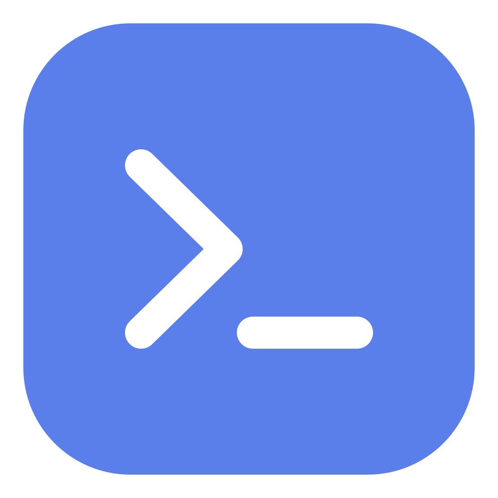

<div align="center">



# Shellink

**Persistent SSH and terminal sessions for people and AI agents.**

[](https://go.dev/)
[](LICENSE)
[](#installation)

[Installation](#installation) · [Quick start](#quick-start) · [Agent workflow](#agent-workflow) · [MCP](#mcp-integration) · [Architecture](#architecture)

</div>

Shellink runs SSH or command-based terminal sessions in a local daemon. The CLI, MCP clients, and Tauri Desktop share those sessions, so work can continue after a client exits. Desktop bundles the Go core and connects through local RPC; it provides session controls, terminal replay/live output, connection management, MCP configuration, Webhook messages, and raw session history.

> **Security:** A command profile runs its configured command with the daemon user's permissions. Only use trusted commands and scripts. The HTTP API listens on localhost by default. Before allowing network access, set a strong `SHELLINK_TOKEN` and put the service behind TLS.

## What it does

- Connects to SSH hosts or starts a local command. macOS and Linux use a pseudo-terminal (PTY); Windows uses anonymous pipes by default, with optional ConPTY support. Command profiles can run trusted `expect` scripts for jump hosts and interactive login flows.
- Keeps terminal sessions alive in the daemon and exposes their state, input/output history, and interactive input.
- Runs commands synchronously or as pollable jobs, uploads and downloads files through the session, and applies exact remote file replacements.
- Supports `AUTO` and `MANUAL` session modes so a person can take control for approvals, passwords, or one-time codes.
- Offers an interactive terminal UI, REST integration APIs, MCP over stdio or HTTP, and stable `--json` output for automation. Desktop is the graphical interface and uses the same daemon as CLI and MCP.
- Retains closed-session records and terminal transcripts for history auditing.
- Stores profiles and encrypted credentials in SQLite. Standalone builds are available for macOS, Linux, and Windows.

## Installation

### Download a release

Download the asset for your platform from [GitHub Releases](https://github.com/jie123108/Shellink/releases/latest).

On macOS or Linux, the installer downloads the matching release and verifies its checksum:

```sh
curl -fsSL https://raw.githubusercontent.com/jie123108/Shellink/main/install.sh -o /tmp/shellink-install.sh
sh /tmp/shellink-install.sh
```

The installer supports macOS and Linux on x64 and arm64. To install a specific release, add `--version vX.Y.Z`.

On Windows, download `shellink-windows-x64.exe` or `shellink-windows-arm64.exe`, rename it to `shellink.exe`, and add its folder to `PATH`. SSH profiles use the system OpenSSH Client. Sessions use anonymous pipes by default. To opt into ConPTY, set `SHELLINK_CONPTY=1` in the daemon's environment before starting it; ConPTY requires Windows 10 version 1809 or newer. Pipe-based sessions do not support local terminal resizing.

Check the installation:

```sh
shellink version
shellink server status --json
```

### Build from source

Requirements:

- Go 1.26 or newer.
- Node.js 22.19 or newer and npm for Desktop or the optional Go build scripts.
- OpenSSH Client for SSH sessions.

Build the CLI / daemon core without frontend dependencies:

```sh
git clone https://github.com/jie123108/Shellink.git
cd Shellink
go build -o dist/shellink ./cmd/shellink
```

On Windows, use `-o dist/shellink.exe`. With Node.js installed, the build script selects the executable name for the current platform:

```sh
npm run build
```

The Go binary contains no browser UI. Build Desktop separately with `npm ci` followed by `npm run desktop:build`; native packaging requires Rust and the [Tauri system dependencies](https://tauri.app/start/prerequisites/). The Tauri package builds and bundles a target-matched Go core. The old browser launcher and its Windows packaging script have been removed.

Cross-compile a specific target or all supported targets:

```sh
npm run build:binary:windows-x64
npm run build:binary:all
```

## Quick start

### Desktop

The [desktop project](docs/desktop-development.md) uses React and Tauri v2. Run `npm run desktop:dev` for the native window or `npm run desktop:build` to package it. The browser Vite server is for frontend development and does not provide backend RPC. The Vue browser console and dedicated DeepSeek Harness adapter have been removed; external AI clients use CLI or MCP.

### CLI and daemon

Start the user-level daemon. Resource commands also start it automatically when needed.

```sh
shellink server start
```

Create a local shell profile. Use the command for your platform:

```sh
# macOS or Linux
shellink profile create --input - --json <<'JSON'
{"name":"local-shell","connectType":"command","command":"/bin/sh"}
JSON
```

```powershell
# Windows PowerShell
@'
{"name":"local-shell","connectType":"command","command":"powershell.exe"}
'@ | shellink profile create --input - --json
```

Use the profile ID returned by the create command:

```sh
shellink session create --profile PROFILE_ID --json
shellink session state SESSION_ID --json
```

Replace `PROFILE_ID` and `SESSION_ID` with the IDs from the preceding command output. Session creation is asynchronous: repeat `session state` until the state is `WAITING_INPUT`, then run:

```sh
shellink session exec SESSION_ID --command "echo Shellink is ready" --json
shellink session history SESSION_ID --since 0 --json
```

Use `shellink cli` for interactive terminal access. Keep the session open to reuse it; when you want to end it, run `shellink session close SESSION_ID --json`. Closing preserves its record and history.

For an SSH profile, set `connectType` to `ssh` and provide `host`, `username`, and optionally `port` (default `22`). Credentials can be supplied in the profile JSON through `--input FILE` or stdin; never pass passwords, private keys, or passphrases as command-line arguments. Profile credentials are encrypted in the local database.

## CLI

Run `shellink --help` for command groups and `shellink agent-doc` for the agent workflow and command reference. The main command groups are:

| Command | Purpose |
| --- | --- |
| `shellink cli` | Open the interactive terminal UI |
| `shellink server ...` | Manage the daemon with `start`, `status`, `stop`, `restart`, `logs`, or `run` |
| `shellink profile ...` | Manage connection profiles with `list`, `get`, `create`, `update`, or `delete` |
| `shellink session ...` | Create and control terminal sessions |
| `shellink webhook ...` | Manage event callbacks |
| `shellink mcp` | Start an MCP server over stdio for an MCP client |
| `shellink agent-doc` | Print the full agent command reference |
| `shellink upgrade` | Check for or install a release update |

Common session commands:

```sh
shellink session list --json
shellink session state SESSION_ID --json
shellink session exec SESSION_ID --command "uname -a" --json
shellink session input SESSION_ID --text "yes" --json
shellink session upload SESSION_ID --input ./local.txt --path /remote/file.txt --json
shellink session download SESSION_ID --path /remote/file.txt --output ./download.txt --json
shellink session edit SESSION_ID --input edits.json --json
shellink session close SESSION_ID --json
```

Use `--detach` for long commands, transfers, or edits, then poll `session exec-status` with the returned job ID:

```sh
shellink session exec SESSION_ID --command "long-build" --detach --json
shellink session exec-status JOB_ID --since 0 --wait 20000 --json
```

`exec-status` and `exec-cancel` take a job ID (positional or `--job`), not a session ID.

Continue polling with the returned cursor as `--since` until `done` is true. To cancel a job, run `shellink session exec-cancel JOB_ID --json`. Remote edits use exact text replacements; each match must occur once, edits cannot overlap, and the session must be in `AUTO` mode and `WAITING_INPUT` state.

### Transfer strategy

Because sessions run through a PTY (including jump-host sessions), file transfer types bytes into the terminal rather than opening an SFTP channel. Uploads and downloads pick the best available strategy automatically:

| Path | When | Behavior |
| --- | --- | --- |
| Raw stream | Upload, remote has `head` and `sha256sum`/`shasum` | Streams raw bytes into a remote `head -c` staging file after one handshake; throughput is bounded by the link, not by round trips. Verified by size and sha256. |
| Chunked base64 | Upload fallback, or small files | Base64 payload per staging command starts at 3400 bytes and halves adaptively when a line wedges the remote tty (canonical input is capped at 1024 bytes on macOS/BSD, 4096 on Linux). |
| Sliced pull | Download of files over 1 MB | Pulls `tail|head` slices with incremental decoding instead of one giant base64 frame. |
| Single frame | Everything else | One marked base64 frame for small downloads and edits. |

Raw streaming falls back to chunked base64 when verification fails (for example a jump host that mangles 8-bit data), and chunked staging is size-verified before decoding, so a degraded link cannot silently corrupt a file. Very large transfers still need a direct connection or a tunnel; the PTY path is for when only a terminal is available.

Session states are `CONNECTING`, `OUTPUTTING`, `WAITING_INPUT`, `IDLE`, and `DISCONNECTED`. Modes are `AUTO` and `MANUAL`.

### Session lifetime and history

Sessions survive CLI and MCP client exits while the daemon is running. Stopping or restarting the daemon ends active sessions; saved records and history remain available.

`session close` ends the terminal process and retains its record. Use `session history SESSION_ID --since 0 --json` to review typed commands and program output after it ends. History hides internal transfer payloads by default; add `--include-internal` to inspect them. The history response contains a `cursor`; pass it as `--since` to read the next page.

To permanently delete a session record and its history, run `shellink session remove-record SESSION_ID --json`. If that session is still active, this also closes it.

## Agent workflow

The CLI is the supported local automation interface. Read its built-in reference before integrating:

```sh
shellink agent-doc
```

A typical workflow is to find a profile, reuse or create a session, check its state, run a command, and inspect output or history. Keep sessions open after completing a task so they can be reused; close them only when the user requests it. Use `--json` for machine-readable results. Wait for `WAITING_INPUT` before sending commands; when a session is in `MANUAL` mode, leave terminal input to the person supervising it.

The optional agent workflow is documented in [shellink-cli/](shellink-cli/):

- `shellink-cli` documents profile, session, input, transfer, and editing workflows.

Install a skill with the [skills CLI](https://skills.sh/), for example:

```sh
npx skills add jie123108/Shellink --skill shellink-cli --agent codex
```

DeepSeek Harness and other AI clients use the same CLI or MCP interface; no client-specific adapter is maintained in this repository.

## MCP integration

Shellink includes an MCP (Model Context Protocol) server for listing and creating profiles, listing and creating sessions, checking session state, reading output, sending input, and closing sessions.

### Local client over stdio

Configure an MCP client to launch `shellink mcp`:

```json
{
  "mcpServers": {
    "shellink": {
      "command": "shellink",
      "args": ["mcp"]
    }
  }
}
```

Use the absolute path to the executable if the client cannot find it in `PATH`. The command starts the daemon automatically when needed and calls it over local RPC. MCP stdio works with `SHELLINK_HTTP_ENABLED=false`.

### Client over HTTP

Enable the daemon HTTP service with `SHELLINK_HTTP_ENABLED=true` (the default). The MCP endpoint requires its own generated bearer token, including for local requests. Obtain the client configuration from `GET /shellink/api/mcp/info` on localhost; remote management requires `SHELLINK_TOKEN`. Manage enablement and token rotation through `POST /shellink/api/mcp/config`. Its persisted configuration is stored in `$SHELLINK_HOME/mcp.json`; the MCP token is separate from `SHELLINK_TOKEN`.

For clients that accept an HTTP URL and authorization headers:

```json
{
  "mcpServers": {
    "shellink": {
      "url": "http://127.0.0.1:7070/shellink/mcp",
      "headers": {
        "Authorization": "Bearer MCP_TOKEN"
      }
    }
  }
}
```

The endpoint accepts JSON-RPC 2.0 requests via HTTP POST and dispatches directly to the daemon's business layer. Adjust the configuration to your client's format. Use the CLI for command execution jobs, file transfers, and remote edits until the MCP tool set is expanded.

## HTTP integration API

HTTP remains available for MCP, incoming Webhook callbacks, health checks, and existing REST integrations. Browser pages and their terminal/event WebSocket routes have been removed. Retained routes use the `/shellink` prefix:

| Route | Purpose |
| --- | --- |
| `/shellink/api/*` | Profiles, sessions, history, webhooks, authentication, and MCP configuration |
| `/shellink/mcp` | MCP over HTTP POST; requires the separate MCP token |
| `/shellink/webhook/callback` | Receive external callback messages via POST |
| `/shellink/healthz` | Liveness check |
| `/shellink/agent.md`, `/shellink/llms.txt` | Agent command reference |

The default HTTP address is `127.0.0.1:7070`. For remote access, bind intentionally, set a strong token, and terminate TLS at a trusted reverse proxy.

## Configuration

Shellink reads configuration from environment variables. User data defaults to `~/.Shellink` on macOS/Linux and `%APPDATA%\Shellink` on Windows.

| Variable | Purpose | Default |
| --- | --- | --- |
| `SHELLINK_HOME` | Data directory | Platform-specific path above |
| `SHELLINK_DB` | SQLite database path | `$SHELLINK_HOME/shellink.db` |
| `SHELLINK_LOG` | Daemon log path | `$SHELLINK_HOME/shellink.log` |
| `SHELLINK_HTTP_ENABLED` | Enable MCP HTTP, Webhook callbacks, and REST APIs | `true` |
| `SHELLINK_HOST` / `SHELLINK_PORT` | HTTP bind address and port | `127.0.0.1:7070` |
| `SHELLINK_TOKEN` | Token for remote API access | `change-me` |
| `SHELLINK_REQUIRE_TOKEN_FOR_SENSITIVE_OPS` | Require an API token for sensitive HTTP operations | Automatic: local requests exempt, remote requests require a token |
| `SHELLINK_MASTER_KEY` | 32-byte key encoded as 64 hex characters | Generated on first start |
| `SHELLINK_CONPTY` | Windows terminal transport; `1` enables ConPTY | Unset (anonymous pipes) |
| `SHELLINK_SSH_READY_TIMEOUT_MS` | SSH connection and login readiness timeout | `30000` |
| `SHELLINK_EXEC_TIMEOUT_MS` | Default command timeout | `20000` |
| `SHELLINK_TRANSFER_MAX_BYTES` | Maximum transfer size | `6291456` |
| `SHELLINK_TRANSFER_TIMEOUT_MS` | Default transfer timeout | `120000` |
| `SHELLINK_EDIT_TIMEOUT_MS` | Default remote edit timeout | `25000` |

Set daemon environment variables before starting it; restart the daemon to apply changes. Keep the master key stable for as long as the database contains encrypted credentials. The generated key is stored in the data directory.

## Architecture

`cmd/shellink/main.go` is the executable entry point; `internal/cli` implements CLI behavior, and the other `internal` packages contain the daemon and service implementation.

| Path | Responsibility |
| --- | --- |
| `cmd/shellink/` | Go executable entry point |
| `internal/` | Go CLI, daemon, SSH/PTY sessions, storage, protocol, and HTTP API |
| `internal/mcpserver/` | Shared MCP tools and JSON-RPC implementation for stdio and HTTP |
| `` | React Desktop interface, bundled Go core, and Tauri local RPC bridge |
| `shellink-cli/` | Agent CLI workflow documentation |
| `docs/architecture.md` | Architecture, current implementation status, and integration plan |

macOS and Linux clients use a Unix domain socket to reach the daemon. Windows uses an authenticated loopback TCP endpoint. CLI and MCP stdio use local RPC; MCP HTTP dispatches in-process. The REST API remains an integration interface.

## Development

```sh
npm ci                      # Install Desktop dependencies
npm run dev                 # Desktop interface preview
npm run dev:server          # Go daemon only
npm run desktop:dev         # Native Desktop window
npm run build               # Go executable only; no frontend build required
npm run build       # Desktop type checking and frontend build
npm run desktop:build       # Native Desktop package for the current OS
go test ./...
go vet ./...
```

Desktop native builds run on the target operating system; build Windows executables on Windows. The Desktop app starts or reuses the local daemon. Session history currently contains raw input and merged PTY output, so it does not claim actor identity, separate stdout/stderr, or command exit codes. Directory browsing, structured operation audit, tray controls, PATH installation, and login startup are not implemented.

## License

Shellink is licensed under the [MIT License](LICENSE).
