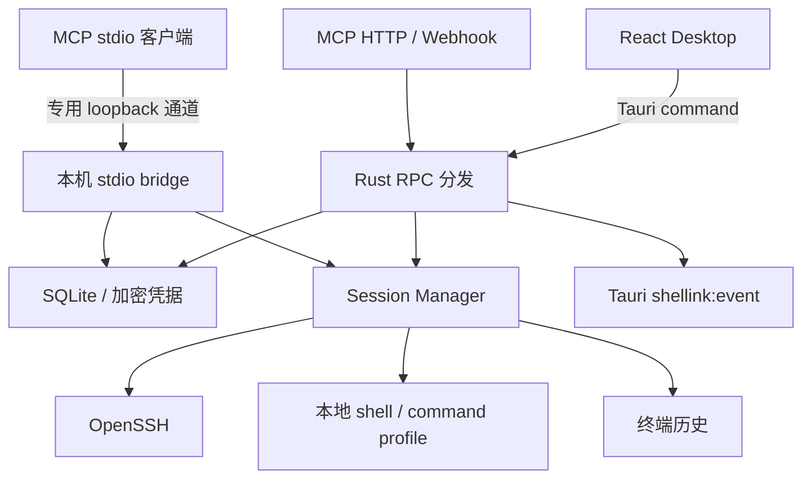

# Shellink Desktop 架构

更新日期：2026-11-03

Shellink 是一个由 Tauri、React 和 Rust 组成的本地终端工作台。桌面进程是唯一的运行宿主：窗口、Rust 核心、SQLite、终端子进程、MCP HTTP 和 Webhook 接收端共享同一个生命周期。关闭主窗口时，HTTP 监听器和全部终端会话都会停止，不留下后台服务。

## 1. 运行时边界



- `src/` 只负责页面状态、终端显示和用户交互，不直接访问数据库或监听端口。
- `src-tauri/src/bridge.rs` 将 Desktop RPC 方法分发到存储、会话和 MCP 服务。
- `src-tauri/src/data.rs` 管理数据目录、SQLite schema、连接配置、加密字段、历史和 MCP 配置。
- `src-tauri/src/sessions.rs` 管理 command/SSH 子进程、输入输出、认证提示、尺寸、历史、关闭和退出回收。
- `src-tauri/src/mcp.rs` 管理 MCP 工具、协议协商和监听器生命周期；`mcp/transport.rs` 处理 HTTP，`mcp/stdio.rs` 负责本机发现与 stdio 转发。
- `src-tauri/src/main.rs` 在普通模式启动桌面窗口；传入 `mcp` 时运行 stdio JSON-RPC 入口。

## 2. 生命周期

启动时，Tauri 初始化 `DataStore`、`SessionManager` 和 MCP `Server`，启动独立的本机 stdio bridge，并根据持久配置及环境变量启动对外 MCP HTTP。stdio 客户端执行桌面程序的 `mcp` 参数，根据私有数据目录中的 `mcp-runtime.json` 找到随机 loopback 端口，因此两种 MCP 入口共享同一数据库和会话。关闭对外 HTTP 不影响 stdio。发现文件仅保存地址与进程号；退出时清除当前进程写入的发现文件。

主窗口收到关闭请求后触发 Tauri exit。退出处理器按以下顺序清理：

1. 停止对外 HTTP 与本机 bridge，关闭连接，取消等待输出的请求并回收请求线程。
2. 关闭所有活动 session 子进程，删除临时 SSH 私钥文件，并将会话写为 `DISCONNECTED`。
3. 清空事件订阅和 Rust 运行时资源。

历史、连接配置和 MCP 配置保留在 SQLite/配置文件中；运行中的进程和监听器不跨窗口存活。

## 3. 数据与安全

默认数据目录为 macOS/Linux 的 `$HOME/.Shellink`，Windows 的 `%APPDATA%\\Shellink`。`SHELLINK_HOME` 可覆盖目录，`SHELLINK_DB` 可指定数据库，`SHELLINK_MASTER_KEY` 可提供 32 字节十六进制主密钥。目录和密钥文件在支持的平台上使用私有权限。

SQLite 当前保存：

- `profiles`：SSH 或本地 command 连接配置。password、private key 和 passphrase 以本地 master key 加密。
- `sessions`：配置快照、目标、名称、来源、模式、尺寸、状态、关闭原因和退出码。
- `history_chunks`：按 session 和 seq 保存输入、输出及纯文本内容。
- `webhooks`：Webhook 对外订阅配置。
- `settings`：键值配置，当前保存 MCP 开关与 bearer token（key=`mcp`，历史版本存于数据目录的 `mcp.json`，启动时自动迁移进表并删除旧文件）。

Webhook 接收消息当前保存在 Desktop 进程内存中，最多保留 200 条；清空窗口或进程退出后消息不会恢复。MCP bearer token 保存在 `settings` 表中，可从 Desktop 页面轮换。

## 4. Desktop RPC

React 通过 `src/backend.ts` 调用 Tauri 的 `core_request`。核心方法包括：

| 范围 | 方法 |
| --- | --- |
| 系统 | `desktop.info`、`system.hello`、`system.ping`、`system.status`、`system.stop` |
| 连接 | `profiles.list`、`profiles.get`、`profiles.create`、`profiles.update`、`profiles.delete` |
| 会话 | `sessions.list`、`sessions.create`、`sessions.state`、`sessions.history`、`sessions.historyChunks`、`sessions.replay`、`sessions.input`、`sessions.mode`、`sessions.resize`、`sessions.rename`、`sessions.close`、`sessions.removeRecord` |
| MCP | `mcp.info`、`mcp.config` |
| Webhook | `webhooks.list`、`webhooks.create`、`webhooks.delete`、`webhooks.messages`、`webhooks.clearMessages` |
| 事件 | `events.subscribe`、`events.unsubscribe` |

会话支持 `AUTO` 和 `MANUAL` 两种协作模式。Desktop 新建会话默认使用 `MANUAL`，用户接管时可直接输入；MCP 创建会话默认使用 `AUTO`。MANUAL 拒绝 MCP 输入，MCP 可主动切回 AUTO；模式切换与输入串行处理。终端输入和输出写入对应 session 的历史，实时输出通过 `shellink:event` 发送，事件订阅可按 `sessionId` 过滤。SSH 认证响应走独立通道，不写入终端历史。

## 5. MCP 与 Webhook

MCP HTTP 默认监听 `127.0.0.1:7070/shellink/mcp`。`SHELLINK_HOST`、`SHELLINK_PORT` 和 `SHELLINK_HTTP_ENABLED=false` 可在启动前调整监听行为。HTTP 请求使用 `Authorization: Bearer <token>`，Desktop 页面展示真实地址、Token 和客户端配置。

当前 MCP 工具覆盖连接配置和基本会话操作：列出/创建 profile，列出/创建 session，读取 session 状态和输出，发送输入，关闭 session。MCP 与 Desktop RPC 使用同一份存储和 `SessionManager`。

HTTP 采用无状态 Streamable HTTP JSON 响应，协商 `2025-06-18` 或 `2025-03-26`，stdio 另兼容 `2024-11-05`。HTTP 校验 Origin、Content-Type、Accept 与协议版本；未实现 SSE 的 GET 返回 405。请求头上限 16 KiB，请求体上限 4 MiB，支持有界的 chunked 请求；每个监听器最多处理 32 个并发连接，并限制读取时间。stdio 设置连接与读写超时，每次请求重新读取 Token，只对认证拒绝重试一次，避免在 I/O 失败后重放终端输入。

工具返回 `structuredContent` 和对应 JSON 文本，声明输出 schema 与只读/破坏性等 annotations。错误使用 `isError` 和稳定的 `error.code/message`。发送输入原样写入 PTY，命令需自带结尾换行才会执行，原始按键不带换行；只含换行的文本即单独发送回车。日志工具每次立即返回最近输出的无状态快照，只需传入 session `id`；唯一的可选参数 `limit` 默认保留最新 200 行文本（最多 10000 行），最终文本按时间正序排列。读取从最新输出片段向前遍历，以 LF 换行分行并保留 CRLF，跨片段拼接完整行，不限制片段数量或字符数。末尾换行不额外增加一行空行；未换行的末尾提示符也算一行。响应包含 `text`、`hasEarlier` 和 `active`，`hasEarlier` 表示行数上限省略了更早文本，`active` 表示会话仍存活，不代表单条命令是否完成。不接受字符数、游标或等待参数，也不保存读取进度，多个 AI 读取同一 session 互不影响；后续输出通过再次读取观察，无变化时仍返回相同文本。ANSI 清理器跨 PTY 数据块保留状态，纯文本内容和原始回放内容分别保存。

Webhook 回调地址为 `/shellink/webhook/callback`，接收 JSON 后向 Desktop 事件总线发布 `webhook.received`，并在内存消息列表中保留最近消息。HTTP 开关同时控制 MCP HTTP 和 Webhook 回调；关闭 Desktop 后二者都不可用。

## 6. 会话执行

command profile 使用平台 shell 启动本地命令。SSH profile 使用系统 OpenSSH，启用伪终端和 keyboard-interactive 认证，通过 `SSH_ASKPASS_REQUIRE=force` 将认证提示交给 Shellink 可执行文件的 askpass 入口（在 Tauri 初始化之前运行）。每个 SSH session 建立随机端口、随机令牌保护的 loopback 通道，保存的 password 或 key passphrase 仅自动回答匹配提示一次；其他提示交给 Desktop 的 MFA/2FA 对话框。`keyboard-interactive` 配置不自动使用保存的凭据。private key 写入 session 期间的数据目录临时文件，session 结束或 Desktop 退出时删除。

`password-mfa` 配置先使用保存的密码，密码通过后由服务器要求短信或动态验证码，再弹出第二步验证窗口。`sessions.authPending` 返回内存中的待处理提示，`sessions.authRespond` 按 session 和 prompt ID 提交单次响应；`session.auth` 事件通知界面刷新，轮询保证漏掉事件或切换页面后仍可恢复提示。认证对话框不依赖 AUTO/MANUAL 模式；等待认证时拒绝常规终端输入，响应不写入 SQLite、事件或终端。多轮提示逐次处理，每轮等待上限为 5 分钟；关闭认证窗口会终止对应 session 并释放通道。

输出读取线程将原始数据写入历史并发布带有 `sessionId`、seq 和 raw 内容的事件。独立回收线程每 100 ms 检查已结束的子进程、写入退出码和关闭原因，不依赖前端查询；MCP 和桌面状态查询也统一经过 SessionManager。`recentOutput` 按时间正序排列，并限制为最近 16000 个字符；`sessions.replay` 返回可用于终端重放的历史内容。

终端尺寸由 `sessions.resize` 持久化。SSH 会话同时发送 `stty cols <cols> rows <rows>`，以便远端 shell 更新尺寸。关闭或删除 session 会终止对应子进程；删除只移除记录，关闭会话不会删除历史。

## 7. 构建与目录

```text
Shellink/
├── src/                         React Desktop 页面
├── src-tauri/src/               Rust 核心与 Tauri 命令
├── src-tauri/tauri.conf.json    原生窗口和打包配置
├── docs/                        架构与开发文档
├── scripts/                     前端辅助脚本
└── package.json                 Vite/Tauri 构建命令
```

开发和验证命令：

```sh
npm ci
npm run desktop:dev
npm run build
cargo check --manifest-path src-tauri/Cargo.toml
cargo test --manifest-path src-tauri/Cargo.toml
```

发行包只包含 Desktop 前端和 Rust 原生核心。Tauri 配置不再声明外部 sidecar；关闭窗口的清理逻辑由同一进程内的 Rust 生命周期负责。
