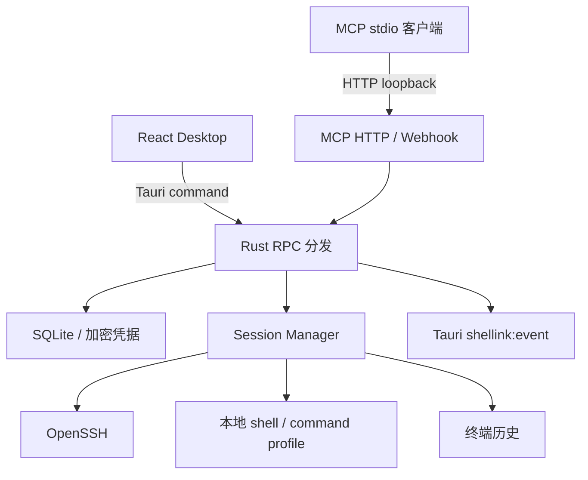

# Shellink Desktop 架构

更新日期：2026-10-31

Shellink 是一个由 Tauri、React 和 Rust 组成的本地终端工作台。桌面进程是唯一的运行宿主：窗口、Rust 核心、SQLite、终端子进程、MCP HTTP 和 Webhook 接收端共享同一个生命周期。关闭主窗口时，HTTP 监听器和全部终端会话都会停止，不留下后台服务。

## 1. 运行时边界



- `src/` 只负责页面状态、终端显示和用户交互，不直接访问数据库或监听端口。
- `src-tauri/src/bridge.rs` 将 Desktop RPC 方法分发到存储、会话和 MCP 服务。
- `src-tauri/src/data.rs` 管理数据目录、SQLite schema、连接配置、加密字段、历史和 MCP 配置。
- `src-tauri/src/sessions.rs` 管理 command/SSH 子进程、输入输出、认证提示、尺寸、历史、关闭和退出回收。
- `src-tauri/src/mcp.rs` 管理 MCP HTTP、Webhook 回调和 stdio 转发。
- `src-tauri/src/main.rs` 在普通模式启动桌面窗口；传入 `mcp` 时运行 stdio JSON-RPC 入口。

## 2. 生命周期

启动时，Tauri 初始化 `DataStore`、`SessionManager` 和 MCP `Server`，然后根据持久配置及环境变量启动 MCP HTTP。stdio 客户端执行桌面程序的 `mcp` 参数，并通过 loopback HTTP 转发到当前 Desktop，因此两种 MCP 入口共享同一数据库和会话。

主窗口收到关闭请求后触发 Tauri exit。退出处理器按以下顺序清理：

1. 停止 MCP HTTP listener，拒绝新的 HTTP 请求。
2. 关闭所有活动 session 子进程，删除临时 SSH 私钥文件，并将会话写为 `DISCONNECTED`。
3. 清空事件订阅和 Rust 运行时资源。

历史、连接配置和 MCP 配置保留在 SQLite/配置文件中；运行中的进程和监听器不跨窗口存活。

## 3. 数据与安全

默认数据目录为 macOS/Linux 的 `$HOME/.Shellink`，Windows 的 `%APPDATA%\\Shellink`。`SHELLINK_HOME` 可覆盖目录，`SHELLINK_DB` 可指定数据库，`SHELLINK_MASTER_KEY` 可提供 32 字节十六进制主密钥。目录和密钥文件在支持的平台上使用私有权限。

SQLite 当前保存：

- `profiles`：SSH 或本地 command 连接配置。password、private key 和 passphrase 以本地 master key 加密。
- `sessions`：配置快照、目标、名称、来源、模式、尺寸、状态、关闭原因和退出码。
- `history_chunks`：按 session 和 seq 保存输入、输出及纯文本内容。
- `webhooks`：Webhook 对外订阅配置。

Webhook 接收消息当前保存在 Desktop 进程内存中，最多保留 200 条；清空窗口或进程退出后消息不会恢复。MCP bearer token 保存在数据目录的 `mcp.json` 中，可从 Desktop 页面轮换。

## 4. Desktop RPC

React 通过 `src/backend.ts` 调用 Tauri 的 `core_request`。核心方法包括：

| 范围 | 方法 |
| --- | --- |
| 系统 | `desktop.info`、`system.hello`、`system.ping`、`system.status`、`system.stop` |
| 连接 | `profiles.list`、`profiles.get`、`profiles.create`、`profiles.update`、`profiles.delete` |
| 会话 | `sessions.list`、`sessions.create`、`sessions.state`、`sessions.history`、`sessions.historyChunks`、`sessions.replay`、`sessions.input`、`sessions.mode`、`sessions.resize`、`sessions.rename`、`sessions.close`、`sessions.removeRecord` |
| MCP | `mcp.info`、`mcp.config` |
| Webhook | `webhooks.list`、`webhooks.create`、`webhooks.delete`、`webhooks.messages`、`webhooks.clearMessages` |
| 事件 | `events.subscribe`、`events.unsubscribe` |

会话支持 `AUTO` 和 `MANUAL` 两种模式。Desktop 新建会话默认使用 `MANUAL`，用户接管时可直接输入；MCP 创建会话默认使用 `AUTO`。每条输入和输出写入对应 session 的历史，实时输出通过 `shellink:event` 发送，事件订阅可按 `sessionId` 过滤。

## 5. MCP 与 Webhook

MCP HTTP 默认监听 `127.0.0.1:7070/shellink/mcp`。`SHELLINK_HOST`、`SHELLINK_PORT` 和 `SHELLINK_HTTP_ENABLED=false` 可在启动前调整监听行为。HTTP 请求使用 `Authorization: Bearer <token>`，Desktop 页面展示真实地址、Token 和客户端配置。

当前 MCP 工具覆盖连接配置和基本会话操作：列出/创建 profile，列出/创建 session，读取 session 状态和输出，发送输入，关闭 session。MCP 与 Desktop RPC 使用同一份存储和 `SessionManager`。

Webhook 回调地址为 `/shellink/webhook/callback`，接收 JSON 后向 Desktop 事件总线发布 `webhook.received`，并在内存消息列表中保留最近消息。HTTP 开关同时控制 MCP HTTP 和 Webhook 回调；关闭 Desktop 后二者都不可用。

## 6. 会话执行

command profile 使用平台 shell 启动本地命令。SSH profile 使用系统 OpenSSH，启用伪终端，并根据加密配置自动回答 password 或 key passphrase 提示。private key 写入 session 期间的数据目录临时文件，session 结束或 Desktop 退出时删除。

输出读取线程将原始数据写入历史并发布带有 `sessionId`、seq 和 raw 内容的事件。后台会回收已退出的子进程、写入退出码和关闭原因；`sessions.replay` 返回可用于终端重放的历史内容。

终端尺寸由 `sessions.resize` 持久化。SSH 会话同时发送 `stty cols <cols> rows <rows>`，以便远端 shell 更新尺寸。关闭或删除 session 会终止对应子进程；删除只移除记录，关闭会话不会删除历史。

## 7. 构建与目录

```text
Shellink/
├── src/                         React Desktop 页面
├── src-tauri/src/               Rust 核心与 Tauri 命令
├── src-tauri/tauri.conf.json    原生窗口和打包配置
├── docs/                        架构与开发文档
├── scripts/                     前端辅助脚本
└── package.json                 Vite/Tauri 构建命令
```

开发和验证命令：

```sh
npm ci
npm run desktop:dev
npm run build
cargo check --manifest-path src-tauri/Cargo.toml
cargo test --manifest-path src-tauri/Cargo.toml
```

发行包只包含 Desktop 前端和 Rust 原生核心。Tauri 配置不再声明外部 sidecar；关闭窗口的清理逻辑由同一进程内的 Rust 生命周期负责。
