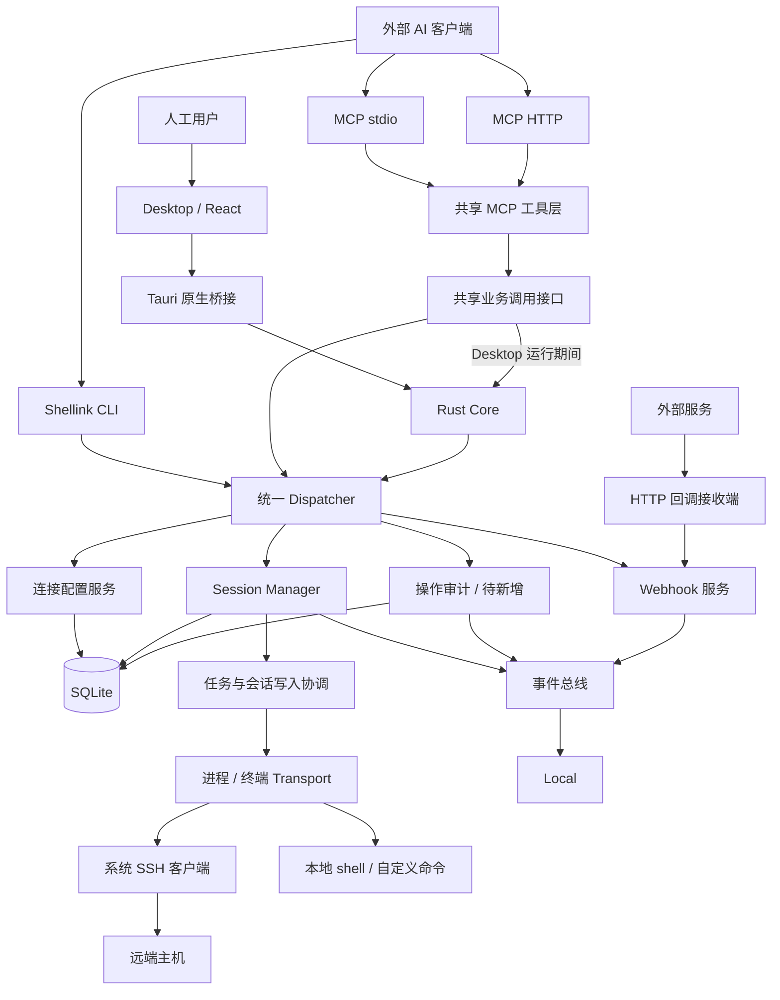
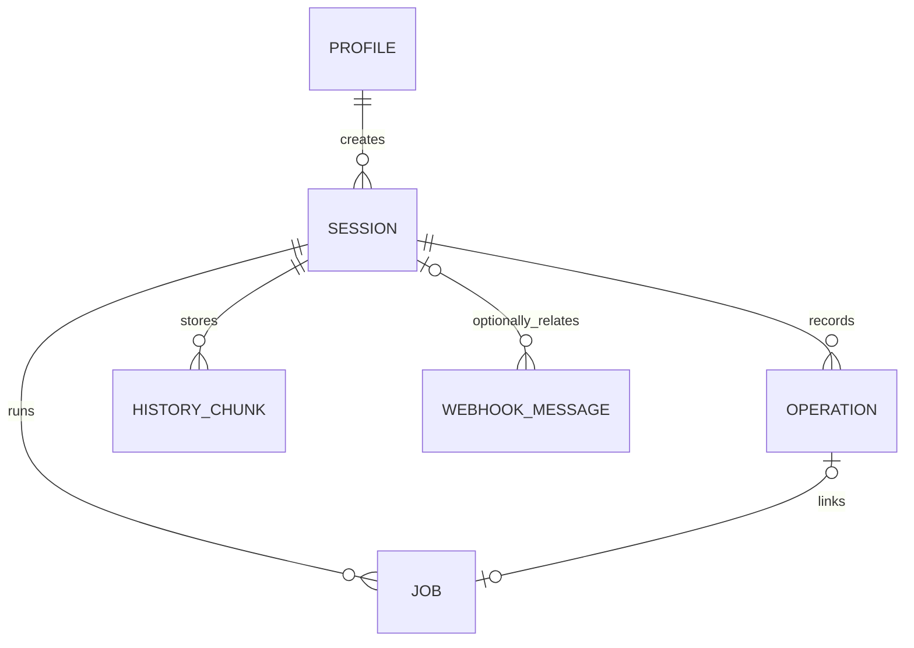

# Shellink 整体架构

更新日期：2026-10-31  
文档用途：评审桌面版的产品结构、进程关系、数据归属和后续接入方案。

**目标架构：Desktop 作为唯一运行宿主，React 与 Tauri/Rust 核心位于仓库根目录。窗口关闭时，终端会话、MCP HTTP 和未完成任务全部停止。浏览器 Web 模块与 `plugin-dsh` 专用适配模块已移除。**

> 当前迁移阶段仍暂时通过 Tauri 私有桥接调用旧 Go 核心；这只是过渡实现。Rust 核心完成后将删除桥接、本地 RPC 和 Go 运行时。前端不直接访问数据库或 HTTP API。本文标出已实现能力及后续工作。

## 1. 产品定位与总体原则

Shellink 是供人工和 AI 共用的持久终端工作台。

- 人工打开桌面应用，管理连接、操作终端、接管会话和查看记录。
- AI 通过 CLI 或 MCP 使用 Desktop 运行期间的核心，发现连接、创建会话、执行操作和读取输出。
- Desktop 是唯一人工图形界面；CLI 和 MCP 是外部自动化入口，运行时受 Desktop 生命周期约束。
- MCP stdio 和 MCP HTTP 的人工配置与管理统一在 Desktop 的「MCP」页面完成，两种传输方式不另设浏览器管理页。
- 会话、任务、连接配置和历史由后台统一管理。GUI、CLI、MCP 都是访问入口。
- 桌面关闭时，MCP HTTP、stdio 接入、终端会话和未完成任务全部停止；已产生的历史写入 SQLite。

核心关系：**一个连接配置可以创建多个 session；一个 session 可以被多个入口观察；每条操作记录都归属明确的 session。**

## 2. 当前实现到了哪里

| 部分 | 当前状态 | 桌面版还需要做什么 |
| --- | --- | --- |
| Rust 核心 | 迁移中；Tauri 工程已上移到仓库根目录，当前仍有旧 Go 过渡桥接 | 完成 SQLite、SSH/PTY、session、任务、MCP HTTP 和 Webhook 的 Rust 实现 |
| 连接配置 | 已有 SSH / 自定义命令、认证信息和 SQLite 存储 | 将桌面表单连接到现有服务 |
| 会话管理 | Desktop 已接入创建、输入、状态、模式、关闭、重命名和历史 | 补齐结构化任务审计和更多运行恢复 |
| 命令与任务 | 已有 exec、异步 job、轮询、取消和文件操作 | 接入任务展示，并扩展审计信息 |
| CLI | 已有稳定命令入口并复用后台业务能力 | 随桌面包提供稳定路径和兼容的命令入口 |
| MCP | 旧 Go 版本已有 stdio / HTTP 和 8 个基础工具；Rust 版本待迁移 | 由 Rust 核心提供 stdio / HTTP，并绑定 Desktop 生命周期 |
| React Desktop | 已连接连接配置、session 生命周期、MCP、Webhook 和历史 RPC | 完整审计、目录浏览/传输 UI 与更多错误恢复 |
| Tauri 原生外壳 | 已上移到仓库根目录；退出时会先请求停止旧运行时 | 删除 Go 桥接，改为进程内 Rust 核心，补齐发行签名和系统集成 |
| 操作审计 | 持久化终端输入输出历史；Desktop 显示未知来源原始片段 | 统一结构化操作者、动作边界、job 结果与退出码 |
| Webhook | 后台内存消息列表和接收地址；Desktop 真实读取、刷新、清空 | 消息持久化与 daemon 重启后的保留 |

Desktop 的创建、重命名、接管、结束、终端回放和实时输出均调用真实后台。新建桌面 session 初始为 MANUAL；手动输入经本地 RPC 写入，AUTO 时页面禁止键盘写入。旧 `web/`、`plugin-dsh/`、浏览器启动器 `launcher/` 及其专用构建依赖已删除；Go 核心构建不依赖前端产物。现有 REST 接口继续作为集成 API 保留，浏览器页面和 WebSocket 路由已移除。

## 3. 进程与通信架构

### 3.1 保留入口的当前调用关系

```text
Desktop：React → Tauri 命令 → Rust Core → 会话 / 任务 / SQLite
                             ├→ MCP HTTP（仅 Desktop 运行期间）
                             └→ MCP stdio（由外部客户端连接 Desktop）

CLI ───────────────────────────────────────┐
                                           ├→ 统一 Dispatcher → 会话 / 任务 / SQLite
MCP stdio ── MCP 工具层 ── 本地 RPC ────────┤
                                           │
MCP HTTP ── MCP 工具层 ── daemon 内直接调用 ─┘
```

迁移完成后，MCP stdio 和 MCP HTTP 都由 Rust 核心提供。stdio 客户端只能连接正在运行的 Desktop，不再自动启动常驻 daemon；Desktop 退出时，HTTP 监听、stdio 接入和全部 session 一起停止。

### 3.2 建议的目标架构

以下为整体目标，其中桌面桥接和 MCP 调用方式已实现；结构化操作审计仍未实现。



目标架构的职责分配：

| 层 | 负责什么 | 主要代码位置 |
| --- | --- | --- |
| 桌面展示层 | 页面、终端渲染、标签、筛选、详情、窗口布局 | `src/` |
| 原生核心层 | Tauri 命令、Rust 服务、窗口退出清理和数据目录操作 | `src-tauri/src/` |
| 访问适配层 | MCP、HTTP、兼容 CLI 接入 | `src-tauri/src/`（迁移中） |
| 业务分发层 | 参数校验、业务调用、统一错误和订阅入口 | `internal/rpc/dispatcher.go`、`internal/service/` |
| 会话执行层 | session 生命周期、模式、任务、输入输出、传输与编辑 | `internal/sessions/` |
| 存储层 | 连接、加密凭证、session 记录、终端历史 | `internal/store/` |
| 运行管理层 | 组装 Rust 服务、监听端点、关闭窗口时停止全部运行资源 | `src-tauri/src/` |

桌面通过 Tauri 的请求接口调用业务，通过事件或通道持续接收输出。React 只维护界面状态与核心快照，持久业务状态以 Rust Core 为准。

`internal/client/` 是 Go 客户端，Rust 不能直接导入使用。接入桌面时，需要在 Rust 侧实现同协议适配，或提供明确的跨语言桥接；应统一协议，避免复制 Go 业务逻辑。

### 3.3 本地通信与 HTTP 的关系

| 通道 | 当前实现 / 目标用途 |
| --- | --- |
| Desktop → Rust Core | Tauri command 与事件通道；Rust Core 与窗口同进程 |
| 外部 MCP stdio | 仅连接正在运行的 Desktop；Desktop 退出后连接立即失效 |
| MCP HTTP | 由 Desktop 内的 Rust Core 监听；窗口关闭时停止监听 |
| 兼容本地 RPC | 迁移过渡期保留旧 Go 接口，Rust 核心完成后删除 |
| Webhook / REST | 随 Desktop 运行；关闭窗口后停止接收 |

HTTP 开关控制 MCP HTTP、Webhook 回调和 REST API 的可用性。Desktop 退出会同时终止这些 HTTP 服务和本地 session；历史记录仍保存在 SQLite。MCP stdio 不自动拉起后台，必须在 Desktop 运行时连接。

界面读取实际运行端点。HTTP 未启用时，回调接收与 MCP HTTP 展示不可用；桌面桥接仍使用本地 RPC。

### 3.4 MCP 统一由 Desktop 管理

MCP stdio 与 MCP HTTP 都在 Desktop 的「MCP」页面操作，按传输方式分别展示配置和状态。以下为桌面管理目标，不表示全部控件已实现。

| 传输方式 | Desktop 中的操作 | 实际运行方式 |
| --- | --- | --- |
| MCP stdio | 查看 Rust MCP 入口、生成和复制客户端配置、检查 Desktop 是否正在运行 | 外部 AI 客户端连接当前 Desktop 提供的 stdio 入口；不启动常驻后台 |
| MCP HTTP | 管理接入启停与 Token、查看实际监听地址、生成和复制客户端连接配置 | 外部 AI 客户端连接 Desktop 内 Rust Core 的 MCP HTTP 端点 |

Desktop 是两种接入方式的统一管理入口，MCP 工具请求仍由外部 AI 客户端发起。stdio 不使用 HTTP 地址或 HTTP Token，也不自动托管常驻后台；页面应区分「配置可用 / Desktop 正在运行」和真实客户端连接状态。

MCP HTTP 的可用性受 HTTP 服务开关和 Desktop 生命周期双重约束。关闭 HTTP 会影响 Webhook 回调和 REST API；关闭 Desktop 会停止所有接入和 session。两种 MCP 接入共用同一套连接、session、任务和历史数据。

## 4. Desktop 的功能组织

保留现有「历史记录」入口，记录以 session 为组织单位。连接配置与「我的连接」使用同一份数据。

| 入口 | 管理内容 | 关系 |
| --- | --- | --- |
| 工作台 | 当前打开的终端标签、分屏、控制权、文件传输和最近操作 | 是 session 的可视窗口 |
| 我的连接 | 已保存的 SSH / 自定义命令配置 | 一个连接可以新建多个 session |
| 会话管理 | 活跃、待接管、已结束、全部会话，以及详情与生命周期操作 | 管理每一个终端实例 |
| MCP | 分别管理 stdio 的路径与启动配置，以及 HTTP 的启停、地址与 Token；展示可确认的状态和工具说明 | 统一承接两种传输方式的桌面管理操作及当前「AI 接入」内容 |
| 历史记录 | 按 session 查阅 AI / 人工的输入、输出与操作结果 | 会话详情和工作台可直接定位对应 session |
| 设置 | 外观、语言、关闭行为、后台、CLI 路径和 Webhook 回调消息 | 管理应用与服务偏好 |

建议收拢的入口：

- 当前「连接管理」页可作为「我的连接 → 管理全部」打开，避免两个一级入口表达同一个对象。
- 当前「AI 接入」可调整为「MCP」，CLI 用法保留在帮助或次级入口。
- 「最近结束的会话」归入「会话管理 → 已结束」。

上述导航收拢是建议，当前原型仍保留「连接管理」「AI 接入」名称；历史按 session 区分与 Webhook 接收消息界面已完成。

## 5. 核心对象与数据归属



这是逻辑关系图，不代表现有数据库已经包含全部实体。Webhook 消息可以不带 session，也可能携带任意发送方定义的关联信息；图中表示当前桌面使用单个可选 `sessionId` 的关联设计。

| 对象 | 含义 | 当前存储情况 |
| --- | --- | --- |
| Profile / Connection | 名称、地址、认证、命令与终端参数等可复用配置 | SQLite `profiles` |
| Session | 从配置创建的一次独立终端实例 | SQLite `sessions`；活跃对象由 daemon 内存管理 |
| Job | 一次命令执行、上传、下载或编辑任务 | 当前主要在 daemon 内存中，重启后不能承诺继续查询原 job |
| Operation | 谁通过哪个入口，对哪个 session 做了什么 | 统一结构化审计待新增；终端历史不提供 actor 与命令边界 |
| HistoryChunk | 按 seq 排序的原始 / 纯文本输入输出片段 | SQLite `history_chunks` |
| WebhookMessage | 外部服务发送来的回调消息 | 当前保留在内存中，最多 200 条；重启后不保留 |
| WebhookSubscription | Shellink 向外部 URL 发送哪些事件的订阅 | SQLite `webhooks`；与收到的消息分开 |

以同一个 `prod-web-01` 连接为例：

```text
prod-web-01（连接配置）
├── sess_7a2c：生产服务巡检
│   ├── 人工接管、检查配置、上传文件
│   └── AI 经 MCP 执行健康检查
└── sess_8b41：部署日志
    └── AI 经 CLI 持续读取日志
```

两个 session 的终端进程、控制权、任务和历史独立。后台归属和界面查询都使用 `sessionId`，不通过主机名猜测记录属于哪个会话。

## 6. 历史记录与操作审计

### 6.1 展示方式

- 从工作台进入历史，默认查看当前 session。
- 从会话详情进入，定位该 session，包括已经结束的会话。
- 选择「全部会话」时按 session 分组，组头显示名称、ID 和状态。
- 在当前范围内使用「全部操作 / AI / MCP / CLI / 人工」筛选。
- 展开一条记录，查看输入、输出、执行状态、时间、耗时和适用的退出码。

「AI」「人工」是操作者分类；「MCP」「CLI」「桌面端」是操作入口。AI 经 CLI 操作时会同时命中 AI 和 CLI 筛选，人工经 CLI 操作也应被正确归类。会话的创建来源、某一次操作的操作者、当前控制权分别存储，不能相互替代。

### 6.2 建议的服务端审计模型

以下为后续接口与存储设计，当前尚未落库：

| 字段 | 含义 |
| --- | --- |
| `operationId` | 单条操作的唯一标识 |
| `sessionId` | 所属会话，主要查询与分组依据 |
| `actorType` | `ai` / `human` / `system` / `unknown` |
| `actorId` / `actorName` | 可识别的调用方与展示名称 |
| `entry` | `desktop` / `cli` / `mcp` / `system` |
| `action` | 命令、交互输入、控制权、传输、会话生命周期等 |
| `input` | 输入或操作参数，按记录策略处理敏感内容 |
| `startedAt` / `endedAt` | 开始与结束时间 |
| `status` | 执行中、完成、失败、等待输入、中断等 |
| `jobId` | 关联异步任务，可为空 |
| `startSeq` / `endSeq` | 对应终端历史范围，可为空 |
| `output` | 终端输出；支持可靠拆分时再提供 stdout / stderr |
| `exitCode` | 可验证的命令退出码，不可用时为空 |

操作在 daemon 接受请求、执行和完成时记录，GUI、CLI、MCP 读取同一份结果。这样窗口关闭期间的操作也能被查询。操作者无法可靠识别时记录为 `unknown`，不依据 CLI / MCP 入口自动断言身份。

当前终端历史已有方向、内容、seq、内部操作标志等字段，但没有上述完整操作者模型。当前 exec 返回状态、输出和耗时，也不等于已经具备每条命令可靠的退出码。

### 6.3 终端流和结构化操作的关系

终端原始输入输出继续保留，结构化审计关联对应的输出范围。两者支持不同的查看目的：审计追溯动作，终端历史还原交互上下文。

PTY 输出通常是合并流，不能保证天然区分 stdout / stderr；人工自由输入也不保证天然存在完整命令边界。真实接入时，只展示后台能够确认的输出、结束条件和退出码。桌面当前拆分 stdout / stderr 的内容是界面示例。

## 7. 会话状态、控制权与生命周期

后台已有运行状态：`CONNECTING`、`OUTPUTTING`、`WAITING_INPUT`、`IDLE`、`DISCONNECTED`。已有控制模式：`AUTO`、`MANUAL`。

桌面的「活跃 / 待接管 / 已结束」是管理视图。其中「待接管」结合运行状态与等待原因产生，例如等待人工认证；它不直接取代后台状态枚举。

| 用户动作 | 目标行为 |
| --- | --- |
| 新建会话 | 根据连接配置创建新的 `sessionId` 和终端实例 |
| 打开会话 | 展示现有实例，已有标签时聚焦该标签 |
| 收起标签 | 关闭视图，会话保持在后台 |
| 人工接管 | 暂停新的自动化写入，人工通过终端操作 |
| 交还控制权 | 由明确的人工操作恢复自动化写入 |
| 结束会话 | 关闭终端进程，记录结束时间与原因，保留历史 |
| 删除记录 | 删除选定记录；对仍活跃实例的联动行为必须明确展示 |
| 关闭桌面窗口 | 默认保留后台；此行为在原生业务接入阶段实现 |
| 停止 MCP HTTP | 只停止该接入端点，不代表结束全部会话 |
| 停止后台服务 | 结束其持有的活跃会话与任务，历史保留 |

接管不等于取消已经运行的远端命令。停止任务应有独立操作。当前后端已有模式检查和任务锁，后续要将模式变更、任务预留和真正写入之间的协调做完整，防止并发输入交错。

应用重开时复用仍在运行的 daemon。daemon 重启时，现有代码会处理遗留会话记录；不能把数据库中存在的 session 直接展示为仍有活跃终端进程。

## 8. MCP 与 CLI 的能力关系

| 能力 | 当前 CLI / 后台 | 当前 MCP | 目标 |
| --- | --- | --- | --- |
| 连接列表与创建 | 已有 | 已有 | 使用同一配置服务 |
| 会话列表、创建、状态、关闭 | 已有 | 已有 | 使用同一 session |
| 输入与读取终端输出 | 已有 | 已有 | 遵守控制权并关联审计 |
| exec 与异步 job | 已有 | 尚未覆盖完整任务接口 | 补齐工具，返回任务 ID 与查询信息 |
| 上传、下载、远程编辑 | 已有 | 尚未提供对应完整工具 | 复用现有后台任务能力 |
| 按游标读取历史 | 后台与 CLI 已有 | 当前基础读取工具能力有限 | 统一游标和输出范围语义 |
| 操作者审计 | 尚无完整统一模型 | 尚无完整统一模型 | 统一记录入口、操作者与结果 |

外部 AI 客户端负责理解用户任务、调用 CLI / MCP。Shellink 负责会话执行、控制权、结果和记录；当前桌面架构不需要额外内置聊天代理或模型推理层。

`plugin-dsh`（npm 包名 `shellink-dsh`）是 DeepSeek Harness 的专用客户端适配器，从目标架构中移除。DeepSeek Harness 等外部 AI 客户端统一通过标准 CLI 或 MCP 接入。原适配器调用的连接、会话、exec、job 和文件操作由 Go 核心继续提供，MCP 尚未覆盖的能力按上表补齐。

## 9. Webhook 消息流

桌面当前展示的主流程：

```text
外部服务
  → POST /shellink/webhook/callback
  → daemon 接收消息
  → 发布 webhook.received 事件
  → 设置 → Webhook 回调 → 收到的消息
  → 可选跳转到 payload.sessionId 对应的历史记录
```

页面展示接收地址、事件名称、接收时间和完整消息原文，支持搜索、筛选、复制、刷新和清空。回调消息可以没有 `sessionId`，清空消息不影响 session 的终端历史或操作审计。

后台同时已有另一个方向：session 状态等事件 → 已注册的 Webhook URL → 外部服务。这属于对外事件订阅，不能用它代替桌面的「收到的消息」。如需管理，可作为后续高级设置保留。

当前收到的消息仅有内存保留能力。如果希望长期查询回调，需要新增持久化与保留策略，不能仅根据原型中的列表认为消息已存入 SQLite。

## 10. 桌面启动与发布包

### 10.1 建议的程序组成

Desktop 是唯一运行宿主，Rust Core 与 Tauri 同进程：

| 入口 | 用户 / 调用方 | 行为 |
| --- | --- | --- |
| Shellink 桌面应用 | 人工双击 | 打开原生窗口并启动 Rust Core；窗口关闭时清理全部运行资源 |
| 外部 CLI | 终端或 AI | 仅在 Desktop 运行期间连接 Rust Core |
| MCP stdio | MCP 客户端 | 连接正在运行的 Desktop，不启动常驻后台 |
| MCP HTTP | MCP 客户端 | 连接 Desktop 内 Rust Core 的 HTTP 端点 |

推荐发行布局示意，Rust Core 与 Desktop 一起打包：

```text
Windows
  Shellink.exe               桌面 GUI
  bin/shellink.exe           兼容 CLI / MCP stdio 客户端

macOS
  Shellink.app/
    Contents/MacOS/...       Tauri GUI
    Contents/Resources/bin/shellink

Linux
  桌面应用及资源目录
  bin/shellink               兼容 CLI / MCP stdio 客户端
```

用户安装发行包后不需要安装 Node.js、Go 或 Rust 开发环境。SSH 仍依赖对应平台可用的 OpenSSH 客户端。单个物理文件内封装全部入口属于额外打包方案，当前原型尚未实现。

### 10.2 启动流程

1. 打开原生窗口，展示工作区准备状态。
2. 在 Rust Core 内打开数据目录和 SQLite，启动 session、MCP HTTP 与 Webhook 服务。
3. 读取连接配置和已结束记录；不存在可恢复的活跃终端，历史 session 不伪装成运行中。
4. 订阅状态和输出事件，恢复上次打开的会话视图。
5. 关闭窗口时先停止 MCP HTTP、Webhook、stdio 接入、session 与任务，再退出 Rust Core。

Rust Core 与窗口同生命周期；关闭窗口后不保留终端进程或 MCP HTTP。当前 Go bridge 仍是过渡实现，Rust Core 完成后删除。

## 11. 接入顺序与验收

| 阶段 | 主要工作 | 验收结果 |
| --- | --- | --- |
| 0. 工程上移（已完成） | Desktop 内容移到仓库根目录，根目录直接运行 Vite/Tauri | `npm run build` 通过，Tauri 配置不再依赖 workspace |
| 1. Rust 数据层 | SQLite schema、凭证加密、Profile、Session、History 映射 | 旧数据库可读取，新数据由 Rust 写入 |
| 2. Rust session | SSH、PTY、输入输出、resize、任务和关闭清理 | 窗口关闭后所有终端进程退出 |
| 3. Rust MCP / HTTP | MCP 工具、stdio、HTTP、Webhook 接入 Rust Core | Desktop 运行时可用，退出后全部端点关闭 |
| 4. Tauri 接入 | 用 Tauri command/event 替换旧 NDJSON bridge | 前端行为保持不变，错误和事件语义一致 |
| 5. 删除 Go | 删除 Go daemon、本地 RPC、过渡桥接和旧构建脚本 | 发行包只包含 Desktop/Rust，不需要 Go |

### 11.1 旧 Web 模块的移除范围

| 范围 | 移除或调整内容 |
| --- | --- |
| 前端工程 | 已删除旧 `web/` Vue 工程及其依赖；Desktop 的 React 界面保留 |
| workspace 与脚本 | 已去掉 `web`、`dev:web` 和 Go 构建中的前端步骤；`npm run dev` 改为 Desktop 预览 |
| Go 静态资源 | 已去掉 `shellink/web`、`embedui`、静态资源处理与专用测试；运行状态不再返回 Web UI 地址 |
| 浏览器路由 | 已移除 `/shellink/ui/` 静态页面与旧浏览器终端、事件 WebSocket；本地 RPC 事件订阅保留 |
| 原启动器 | 已删除 `launcher/` 和旧 `package:windows` 脚本；使用 `desktop:build` 构建 Tauri 窗口，随包核心与后台启动桥接待实现 |
| MCP 调用依赖 | 已迁移至共享业务调用接口；stdio 走本地 RPC，HTTP 直接分发。REST 集成接口继续保留 |
| 保留能力 | 连接、会话、历史、任务、MCP HTTP 和 Webhook 回调迁移到 Rust Core |

旧界面的功能由 Desktop 承接，目前仍为界面原型。MCP 状态、启停、Token 与配置等 HTTP 管理能力仍可使用，后续需要补齐相应本地调用接口。现有连接和历史数据继续复用，移除旧前端未删除用户数据。

### 11.2 plugin-dsh 的移除范围

| 范围 | 移除或调整内容 |
| --- | --- |
| 适配器工程 | 已删除 `plugin-dsh/`，包括客户端、工具封装、Harness 审批集成、`cordis.patch.yml` 和专用测试 |
| workspace 与脚本 | 已去掉根 workspace 中的 `plugin-dsh` 和 `test:plugin-dsh`；仓库不再构建或测试该模块 |
| 依赖与锁文件 | 已清理专用 DeepSeek Harness、Cordis、Vue 等依赖与 lockfile 条目；npm workspace 仅保留 Desktop |
| 安装与开发说明 | 已更新 README 的安装、目录和测试说明，AI 接入统一指向 CLI / MCP；历史 CHANGELOG 保留原发布事实 |
| 包发布 | 仓库内不再提供 `shellink-dsh` 的构建与发布入口；未变更已发布包或外部 Harness 配置 |
| 核心能力 | 会话引擎、连接与凭证存储、任务、文件操作和历史继续由 Go 核心提供 |

移除专用适配器后，CLI / MCP 仅在 Desktop 运行期间接入 Rust Core；Desktop 按同一业务与审计模型接入。REST 接口作为运行期间的集成入口保留，不再承担浏览器资源或实时 WebSocket 传输。

本轮已完成旧 Web 与 `plugin-dsh` 的源码、依赖、构建和浏览器启动器清理，以及 MCP 调用层迁移。Desktop 的真实后台桥接、完整操作审计和核心随包启动仍为后续工作。

## 12. 代码与相关文档

| 位置 | 内容 |
| --- | --- |
| [`src/`](../src/) | 当前桌面界面 |
| [`src-tauri/`](../src-tauri/) | 原生窗口与打包 |
| [`cmd/shellink/`](../cmd/shellink/) | Go 核心程序入口 |
| [`internal/app/runtime.go`](../internal/app/runtime.go) | 后台服务组装与生命周期 |
| [`internal/client/`](../internal/client/) | Go 本地 RPC 客户端 |
| [`internal/localipc/`](../internal/localipc/) | 平台通信端点 |
| [`internal/rpc/dispatcher.go`](../internal/rpc/dispatcher.go) | 统一方法分发 |
| [`internal/sessions/`](../internal/sessions/) | 会话、终端、任务和传输 |
| [`internal/store/store.go`](../internal/store/store.go) | 当前数据库实体与表结构 |
| [`internal/mcpserver/`](../internal/mcpserver/) | 当前 MCP 工具与协议 |
| [`internal/webhooks/service.go`](../internal/webhooks/service.go) | 回调接收、内存消息及对外事件发送 |

相关说明：[桌面工程使用说明](desktop-development.md)、[会话管理设计](design/session-management.md)、[桌面重设计草案](desktop-redesign.md)。旧草案中的目标描述与现状冲突时，以本文件的状态说明及当前代码为准。
